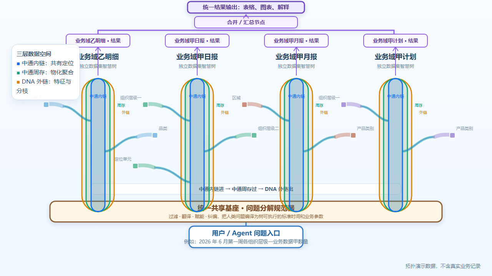

# 链式多维时空 AI 数据引擎

> **发布副本（2026-10-08）**：本目录只包含源码、测试、脚本、依赖锁和最终说明。业务 Excel、SQLite、导入 Blob、会话、日志和编译产物已刻意排除；部署后需要重新配置、导入和验收。

本工作区按职责分为三部分：

| 目录 | 内容 |
| --- | --- |
| [AI数据引擎](AI数据引擎/) | Legacy AI 数据引擎源码、前端、测试与部署模板 |
| [Agent](Agent/) | DeepSeek Harness Agent Gateway、MCP、Skills、Presets、测试和升级方案 |
| [自研AI数据引擎](自研AI数据引擎/) | CNTS 自研二进制数据引擎、Rust 核心、Python 构建器、声明、契约与验证脚本 |
| [演示动画](演示动画/) | 基于 Remotion 的智慧树查询原理动画、封面、可复现源码与分镜说明 |
| [说明文件/脚本](说明文件/脚本/) | Legacy 引擎、Agent Gateway 与前端的启动和停止脚本 |

## GitHub 副本边界

- 业务数据应放在 `AI数据引擎/数据源/`，或通过 `CHAIN_SOURCE_DATA_ROOT` 指向仓库外目录；该目录只保留使用说明。
- 旧引擎的 SQLite 和智慧树运行态、Agent 会话/附件、CNTS Catalog 与二进制段均在本机 `data/` 目录生成，不被版本控制。
- 复制 `.env.example` 为本机 `.env` 或在部署环境注入变量；严禁提交密钥、令牌或真实服务地址。
- 本仓库含三个可独立演进的组件：旧版 AI 数据引擎、Agent Gateway 和 CNTS 自研引擎。生产切换前应分别完成构建、数据导入和验收。

## 文档入口

1. [产品架构与数据治理](docs/产品架构与数据治理.md)
2. [部署运行与运维](docs/部署运行与运维.md)
3. [验收、迁移与演进](docs/验收、迁移与演进.md)

## 产品演示

[](演示动画/预览/智慧树查询原理.mp4)

观看 [智慧树查询原理动画](演示动画/预览/智慧树查询原理.mp4)，或进入 [演示动画源码与分镜说明](演示动画/README.md)。动画使用模拟拓扑数据，展示从用户问题入口、统一基座、数据集智慧树三层空间、侧向分枝、数据集结果，到合并汇总和统一输出的全过程；不包含真实业务数据。

## 启动

```powershell
$env:DEEPSEEK_API_KEY = "部署环境密钥"
$env:ENGINE_SERVICE_TOKEN = "高强度内部服务令牌"
.\说明文件\脚本\启动全部.ps1
```

启动后打开：`http://127.0.0.1:5173/agent`。

## 架构边界

- AI 数据引擎可以独立运行，也可以被其他自建 Agent 调用。
- Agent 只通过 HTTP/MCP 访问数据引擎，不读取其内部存储。
- Skill 是可选增强；没有匹配 Skill 时使用通用 Agent 动态规划。
- CNTS 是隔离的候选存储实现，只有管理员通过完整运行配置档明确激活后才会成为查询引擎。

## 引擎选择与启用

两套引擎使用同一套 Agent 查询通道和业务语义，差异只在物理存储、构建方式与变更边界；切换引擎不要求替换 Agent、模型通道或调用方代码。

| 选择 | Legacy AI 数据引擎 | 自研 CNTS AI 数据引擎 |
| --- | --- | --- |
| 适用阶段 | 数据集频繁注册、导入、注销或调整字段/智慧树规则时 | 数据集、基座语义和规则已稳定，需要压缩存储、固定版本与只读高效查询时 |
| 物理存储 | SQLite、导入数据和运行态拓扑 | 不可变二进制 generation 与多数据集 Catalog |
| 数据变更 | 在数据集管理中完成注册、确认、导入和智慧树重建 | 先由 Legacy 只读构建候选 Catalog，完成对账后发布新 generation |
| 启用方式 | 使用当前已激活的 Legacy 运行配置档 | 在“AI 引擎与数据集”中一次性激活已验收的 CNTS 配置档 |
| 失败处理 | 由管理员诊断、修复和重新执行 | 不会自动回退 Legacy；管理员必须显式切换完整配置档 |

```text
需要继续导入或调整数据集、基座特征、时间规则、阈值？
  -> 是：使用 Legacy，完成数据治理与智慧树重建
  -> 否：构建 CNTS 候选 Catalog
           -> 检查结构、质量、查询对账和业务口径
           -> 管理员激活完整 CNTS 配置档
           -> Agent 继续经原有 HTTP/MCP 查询，无需改变调用方式
```

CNTS 的候选构建与命令见 [自研 AI 数据引擎](自研AI数据引擎/README.md)，完整迁移和验收门槛见 [验收、迁移与演进](docs/验收、迁移与演进.md)。

## 开源许可

项目自有的源码与文档采用 [Apache License 2.0](LICENSE)，版权归属见
[NOTICE](NOTICE)。该许可允许使用、修改、再发布和商用，但要求保留适用的
许可证、版权和归属声明；其中也包含专利授权与免责条款。

根许可不覆盖依赖包、模型服务、外部数据、用户导入文件或带有独立版权/许可
声明的材料。依赖清单、再发布注意事项和审计边界见
[THIRD_PARTY_NOTICES.md](THIRD_PARTY_NOTICES.md)。
